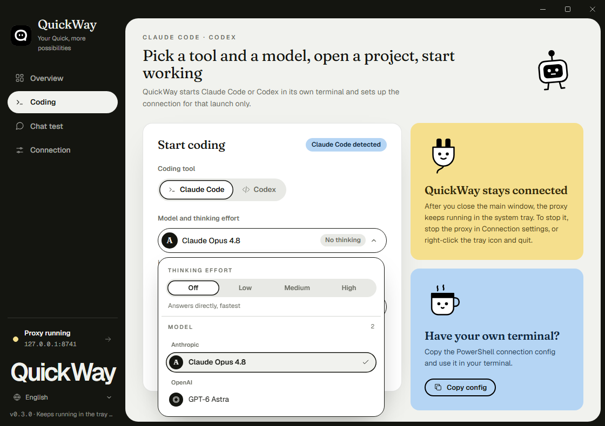
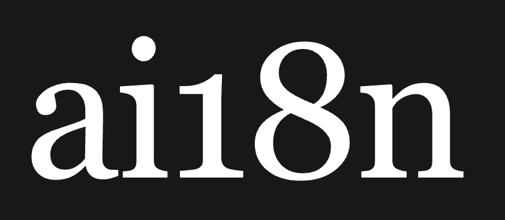

<p align="center">
  
</p>
<h1 align="center">QuickWay</h1>
<h3 align="center">Ваш шлюз к Amazon Quick</h3>
<p align="center">Используйте модели Quick в Claude Code, Codex и любых приложениях, совместимых с OpenAI или Anthropic, через локальный API</p>

<p align="center">
  <a href="../README.md">🇺🇸 English</a> • <a href="README_zh.md">🇨🇳 中文</a> • <a href="README_ja.md">🇯🇵 日本語</a> • <a href="README_ko.md">🇰🇷 한국어</a> • 🇷🇺 Русский • <a href="README_es.md">🇪🇸 Español</a> • <a href="README_pt.md">🇧🇷 Português</a> • <a href="README_id.md">🇮🇩 Indonesia</a> • <a href="README_vi.md">🇻🇳 Tiếng Việt</a>
</p>

<p align="center">
  <a href="https://github.com/hnewcity/QuickWay/actions/workflows/ci.yml"></a>
  <a href="../LICENSE"></a>
  
  <a href="http://makeapullrequest.com"></a>
</p>

<p align="center">
  
</p>

---

## ❤️ Спонсор

<table>
<tr>
<td width="180"><a href="https://ai18n.chat"></a></td>
<td>Благодарим <a href="https://ai18n.chat">ai18n</a> за спонсорство проекта! ai18n — надёжный и эффективный провайдер API-ретрансляции, предоставляющий ретрансляцию моделей Claude для OpenClaw, Claude Code, Codex, Gemini и других инструментов.</td>
</tr>
</table>

---

QuickWay — это настольный шлюз, который открывает модели вашей учётной записи Amazon Quick через локальный API, совместимый с Anthropic и OpenAI. Используйте Quick в Claude Code, Codex и любимых SDK и инструментах без изменений в коде.

## ✨ Возможности

| Возможность | Описание |
|---|---|
| 🔌 **API, совместимый с Anthropic** | Эндпоинт `/v1/messages` для Anthropic SDK и Claude Code |
| 🔌 **API, совместимый с OpenAI** | Эндпоинты `/v1/chat/completions` и `/v1/responses` для OpenAI SDK и Codex |
| 🚀 **Запуск для разработки** | Запуск Claude Code или Codex в отдельном терминале одним щелчком; у каждого своя модель и уровень |
| 🧠 **Глубина размышления** | Выкл. / Низкая / Средняя / Высокая — соответствует нативным настройкам рассуждения каждой модели |
| 📋 **Динамический каталог моделей** | Модели читаются из вашей учётной записи Quick и обновляются автоматически |
| 🛠️ **Вызов инструментов** | Вызов функций в Messages, Chat Completions и Responses |
| 👁️ **Поддержка изображений** | Отправка изображений base64 модели |
| 📡 **Потоковая передача** | Полная поддержка SSE-стриминга |
| 💬 **Встроенный чат** | Проверьте настройки во встроенном чате |
| 🔐 **Локальная работа и безопасные учётные данные** | Прокси только на loopback со своим API-ключом; токены хранятся только в памяти и берутся из диспетчера учётных данных Windows или связки ключей macOS |
| 🔄 **Перенос учётных данных** | Экспорт и импорт учётных данных между вашими компьютерами с Windows и macOS |
| 🔗 **Интеграция с CC Switch** | Импорт в [CC Switch](https://github.com/farion1231/cc-switch) для Claude Code одним щелчком |
| 🌍 **Многоязычный интерфейс** | English, 中文, 日本語, 한국어, Русский, Español, Português, Indonesia, Tiếng Việt |
| 🩺 **Диагностика** | Копирование отчёта с замаскированными данными, если проверка подключения или лимитов не удалась |

## 📦 Установка

### Скачать

Скачайте последнюю версию на странице [GitHub Releases](https://github.com/hnewcity/QuickWay/releases):

| Платформа | Архитектура | Скачать |
|---|---|---|
| macOS | Apple Silicon (M1/M2/M3) | [QuickWay_x.y.z_aarch64.dmg](https://github.com/hnewcity/QuickWay/releases/latest) |
| macOS | Intel | [QuickWay_x.y.z_x64.dmg](https://github.com/hnewcity/QuickWay/releases/latest) |
| Windows | Установщик x64 | [QuickWay_x.y.z_x64-setup.exe](https://github.com/hnewcity/QuickWay/releases/latest) |
| Windows | Портативная версия x64 | [QuickWay_x.y.z_x64-portable.exe](https://github.com/hnewcity/QuickWay/releases/latest) |

> Требуется Windows 10/11 x64 или macOS 12+. Установщик Windows не подписан, а сборки macOS подписаны ad-hoc без нотаризации, поэтому при первом запуске SmartScreen или Gatekeeper могут запросить подтверждение. Сначала войдите в Amazon Quick на том же компьютере.

### Сборка из исходников

```bash
# Клонировать репозиторий
git clone https://github.com/hnewcity/QuickWay.git
cd QuickWay/desktop

# Установить зависимости
npm ci

# Запустить в режиме разработки
npm run tauri dev

# Или собрать для продакшена
npm run desktop:build
```

Нужны Rust (версия указана в `rust-toolchain.toml`) и Node.js 20.19+ или 22.12+. На macOS также установите Xcode Command Line Tools.

## 🚀 Быстрый старт

1. **Войдите** в Amazon Quick на этом компьютере
2. **Запустите** QuickWay — он автоматически подхватит выбранную учётную запись
3. **Откройте** вкладку «Разработка», выберите Claude Code или Codex, модель и папку проекта, затем нажмите «Запустить»
4. **Или** используйте `http://127.0.0.1:8741` как адрес Anthropic / OpenAI API, а ключ API возьмите в настройках подключения

> ID моделей зависят от вашей учётной записи. Используйте ID из ответа `GET /v1/models`.

### Пример: cURL

```bash
curl http://127.0.0.1:8741/v1/chat/completions \
  -H "Content-Type: application/json" \
  -H "Authorization: Bearer YOUR_PROXY_API_KEY" \
  -d '{
    "model": "claude-sonnet-4-6",
    "messages": [{"role": "user", "content": "Hello!"}]
  }'
```

### Пример: Python (OpenAI SDK)

```python
from openai import OpenAI

client = OpenAI(
    base_url="http://127.0.0.1:8741/v1",
    api_key="YOUR_PROXY_API_KEY"
)

response = client.chat.completions.create(
    model="claude-sonnet-4-6",
    messages=[{"role": "user", "content": "Hello!"}]
)
print(response.choices[0].message.content)
```

### Пример: JavaScript (OpenAI SDK)

```javascript
import OpenAI from 'openai';

const client = new OpenAI({
  baseURL: 'http://127.0.0.1:8741/v1',
  apiKey: 'YOUR_PROXY_API_KEY',
});

const response = await client.chat.completions.create({
  model: 'claude-sonnet-4-6',
  messages: [{ role: 'user', content: 'Hello!' }],
});
console.log(response.choices[0].message.content);
```

## 🔌 Совместимость

| Категория | Инструменты |
|---|---|
| **Агенты для разработки** | Claude Code, Codex CLI |
| **Python** | OpenAI SDK, Anthropic SDK, LangChain, LlamaIndex |
| **JavaScript** | OpenAI Node.js SDK, Anthropic SDK, Vercel AI SDK |
| **Инструменты** | CC Switch, Cursor, Continue, Cline |

## ⚙️ Конфигурация

### Методы аутентификации

| Метод | Описание |
|---|---|
| **Локальный вход в Quick** | Читает вошедшую учётную запись Amazon Quick (диспетчер учётных данных Windows или связка ключей macOS) — рекомендуется |
| **Импортированные учётные данные** | Файл `.qwc`, экспортированный с другого вашего компьютера |

### Настройки сервера

| Параметр | По умолчанию | Описание |
|---|---|---|
| Хост | `127.0.0.1` | Только loopback; прокси не слушает другие интерфейсы |
| Порт | `8741` | Порт сервера, меняется в настройках подключения |
| API-ключ прокси | создаётся автоматически | Обязателен для каждого запроса: `x-api-key` или `Authorization: Bearer` |

### Расширенные настройки

| Параметр | Описание |
|---|---|
| Глубина размышления | Выкл. / Низкая / Средняя / Высокая для каждого чата или запуска, либо заголовок запроса `x-quickway-thinking-effort` |
| Каталог моделей | Обновляется каждые 5 минут или вручную из панели чата |
| Запуск с приложением | Автоматически запускать прокси при открытии QuickWay |

## 🛠️ Технологический стек

| Слой | Технология |
|---|---|
| **Фронтенд** | TypeScript + Vite |
| **Десктоп** | Tauri 2 (Rust) |
| **Бэкенд** | Rust + axum |

## 🤝 Вклад в проект

Мы рады любому вкладу! Вы можете:

- 🐛 Сообщать об ошибках через [GitHub Issues](https://github.com/hnewcity/QuickWay/issues)
- 💡 Предлагать функции
- 🔧 Отправлять pull request
- 🌍 Помогать с переводами

## 📚 Документация

- [User guide (中文)](USER_GUIDE_zh.md): подробное руководство: учётные данные, модели, API, совместимый с OpenAI, и Codex
- [Выпуск релизов](RELEASING.md): как обновляются версии и публикуются релизы

## 📄 Лицензия

[MIT](../LICENSE) © QuickWay Contributors
